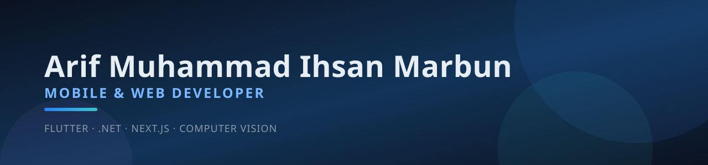
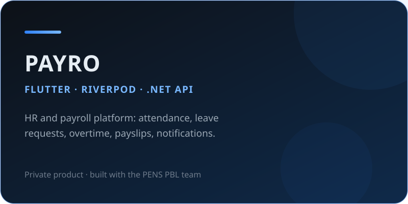
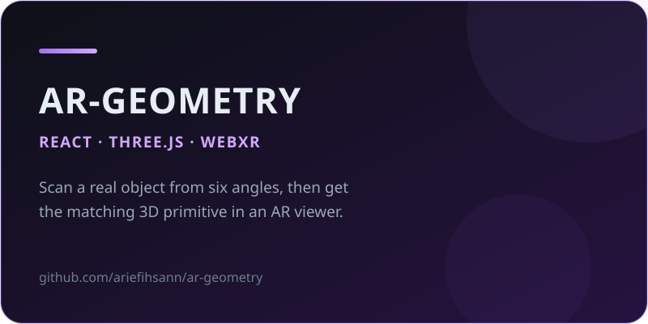
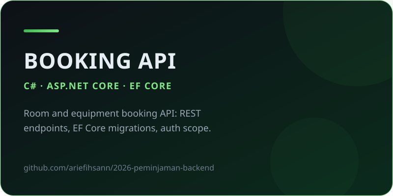
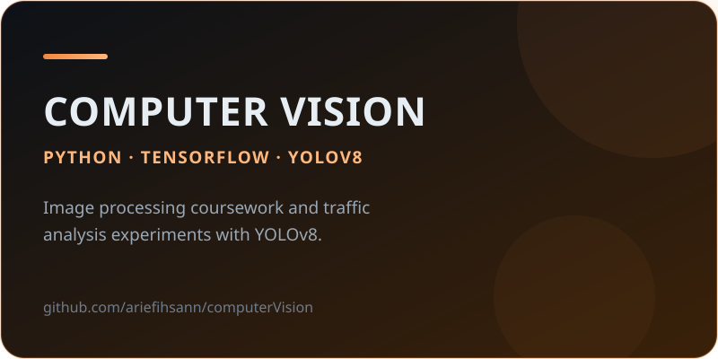
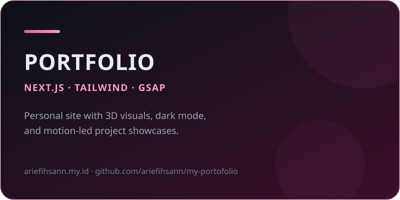
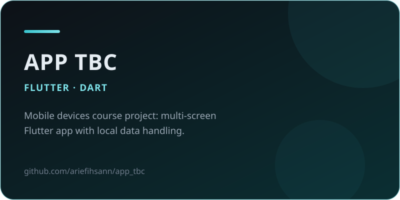

  
    

  
  
  
  

 

## About

I am a mobile and web developer who likes shipping products end to end: a Flutter app with clean, testable state management on the front, and a well-structured API behind it. I care about readable code, predictable state, and interfaces that behave the same on a low-end Android phone as they do on a flagship.

I am currently part of the **PENS PBL** team building **PAYRO** — an HR and payroll platform covering attendance, leave and overtime requests, payslips, and in-app notifications. Outside of that, I build small products to keep the full stack sharp: Laravel back offices, Next.js sites, and computer vision experiments on the side.

| What I do | How I do it |
| :-- | :-- |
| **Mobile engineering** | Flutter apps structured around Riverpod, clear layering, and dependable REST integration |
| **Backend & API** | ASP.NET Core Web APIs with EF Core, plus Laravel for smaller products |
| **Interface engineering** | Next.js and React frontends with Tailwind, and 3D / WebXR work with Three.js |
| **Applied CV** | Python workflows with TensorFlow and YOLOv8 for detection and traffic analysis |

## Tech stack

| | |
| :-- | :-- |
| **Mobile** |     |
| **Backend** |       |
| **Frontend** |       |
| **Data & AI** |      |
| **Tooling** |      |

## Featured projects

<table>
  <tr>
    <td width="50%" align="center">
      
    </td>
    <td width="50%" align="center">
      
    </td>
  </tr>
  <tr>
    <td width="50%" align="center">
      
    </td>
    <td width="50%" align="center">
      
    </td>
  </tr>
  <tr>
    <td width="50%" align="center">
      
    </td>
    <td width="50%" align="center">
      
    </td>
  </tr>
</table>

**More work**

- [`studyBuddy`](https://github.com/ariefihsann/studyBuddy) — study companion app built with Next.js and TypeScript
- [`emosver-software`](https://github.com/ariefihsann/emosver-software) — ROS workspace for the EMOSVER robot software stack
- [`finance-tracker`](https://github.com/ariefihsann/finance-tracker) — Laravel personal finance tracker with balance reporting
- [`sistem-voting-osis`](https://github.com/ariefihsann/sistem-voting-osis) — Laravel voting system for student council elections
- [`Sistem-Bimbel`](https://github.com/ariefihsann/Sistem-Bimbel) — tutoring center management system

## Achievements

| Year | Recognition | Detail |
| :--: | :-- | :-- |
| 2026 | **Project Manager** — EMOSVER PENS | Operations lead of the PENS underwater robotics team competing in KRBAI |
| 2023 | **1st place, Informatics** — OSN-K | National Science Olympiad, regency level (Aceh Selatan) |
| 2023 | **1st place, Content Creator** — Pelajar Pelopor Keselamatan Lalu Lintas | Road safety campaign video, provincial level (Aceh) |
| Ongoing | **OSNK Informatics mentor** | Coaching high school students for the National Science Olympiad |

**GitHub achievements** — 

**Highlights**

- Shipped the attendance, leave and overtime, notification, and payslip flows of **PAYRO** with the PENS PBL team.
- Deployed three public products: the [portfolio site](https://ariefihsann.my.id/), the [ar-geometry AR demo](https://ariefihsann.github.io/ar-geometry/), and studyBuddy.
- 30 public repositories across Flutter, .NET, Laravel, Next.js, and computer vision.

## GitHub activity

  <picture>
    <source media="(prefers-color-scheme: dark)" srcset="https://github-profile-summary-cards.vercel.app/api/cards/profile-details?username=ariefihsann&theme=github_dark" />
    
  </picture>
   
  <picture>
    <source media="(prefers-color-scheme: dark)" srcset="https://streak-stats.demolab.com?user=ariefihsann&theme=github-dark-blue&hide_border=true" />
    
  </picture>

## Contact

| | |
| :-- | :-- |
| **Email** | [arifmuhammadihsan27@gmail.com](mailto:arifmuhammadihsan27@gmail.com) |
| **LinkedIn** | [linkedin.com/in/arifmuhammadihsan](https://www.linkedin.com/in/arifmuhammadihsan/) |
| **Portfolio** | [ariefihsann.my.id](https://ariefihsann.my.id/) |
| **Location** | Surabaya, Indonesia (UTC+7) |

Open to collaboration on Flutter apps, HR and payroll products, and backend integrations. The fastest way to reach me is email.
